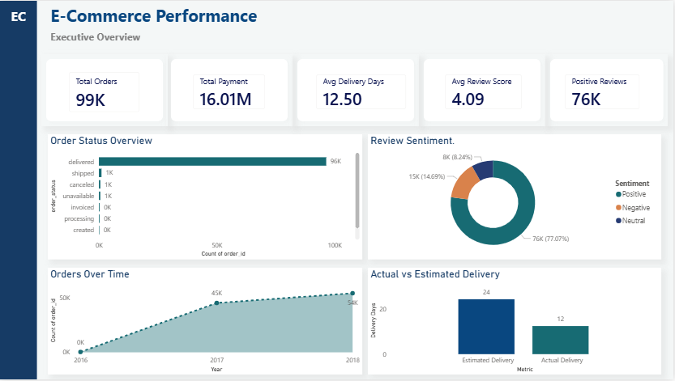

# E-Commerce Performance Analysis

An end-to-end analysis of Brazilian e-commerce data using **Python, SQL, and Power BI** to evaluate order performance, payment behavior, delivery efficiency, and customer satisfaction.



---

## 📌 Project Overview

This project analyzes the **Brazilian E-Commerce Public Dataset by Olist**, a large transactional dataset containing information about orders, customers, payments, reviews, products, sellers, and order items.

The objective was to transform raw e-commerce data into meaningful business insights through an end-to-end analytics workflow:

**Data Exploration → Data Cleaning → SQL Analysis → Power BI Modeling → DAX → Business Dashboard → Insights**

The final Power BI dashboard provides an executive-level view of operational performance and customer experience.

---

## 🎯 Business Objectives

The analysis focuses on understanding:

- Overall order volume and order trends
- Payment behavior and total payment value
- Order status and fulfillment performance
- Actual delivery time versus estimated delivery time
- Customer review performance
- Positive, neutral, and negative review distribution
- Changes in order activity over time

---

## 📊 Key Performance Indicators

| KPI | Result |
|---|---:|
| **Total Orders** | 99,441 |
| **Total Payment Value** | 16.01M |
| **Average Delivery Time** | 12.50 days |
| **Average Review Score** | 4.09 / 5 |
| **Positive Reviews** | 76,470 |

---

## 🔍 Key Business Insights

### Order Performance

The dataset contains **99,441 orders** across the available period.

The majority of orders were successfully delivered, with approximately **96,478 orders** recorded as delivered.

This indicates a strong overall fulfillment rate, while the remaining order statuses highlight smaller operational segments such as shipped, canceled, unavailable, invoiced, and processing orders.

### Payment Performance

The total recorded payment value is approximately **16.01 million**.

**Credit card** was the dominant payment method, accounting for the largest share of payment records and payment value.

Other payment methods included boleto, voucher, and debit card.

### Delivery Performance

The average actual delivery time was approximately **12.5 days**, while the average estimated delivery time was approximately **24.4 days**.

This indicates that orders were delivered substantially earlier than the estimated delivery date on average.

The comparison between actual and estimated delivery performance is one of the key operational insights highlighted in the Power BI dashboard.

### Customer Satisfaction

The average review score was approximately **4.09 out of 5**.

A total of **76,470 reviews** were classified as positive, using review scores of 4 and 5.

The review distribution is strongly concentrated around high ratings, with 5-star reviews representing the largest review category.

---

## 🛠️ Tools & Technologies

| Tool | Purpose |
|---|---|
| **Python** | Data exploration, cleaning, validation, and analysis |
| **Pandas** | Data manipulation and exploratory analysis |
| **SQL / SQLite** | Business analysis and metric validation |
| **Power BI** | Data modeling, DAX, visualization, and dashboard development |
| **GitHub** | Version control and project documentation |

---

## 🔄 Analytical Workflow

### 1. Data Exploration & Preparation — Python

The datasets were explored using Python and Pandas to understand:

- Dataset structure
- Data types
- Missing values
- Duplicate records
- Date fields
- Categorical variables
- Relationships between datasets

Data quality checks were performed before using the data for downstream analysis.

The Python exploration notebook is available here:

[`01_data_understanding.ipynb`](01_data_understanding.ipynb)

---

### 2. SQL Business Analysis

SQL was used to answer business-focused questions and validate key metrics.

The analysis included:

- Total order volume
- Orders by year
- Order status distribution
- Payment method performance
- Total payment value
- Average order value
- Delivery performance
- Review score distribution
- Review sentiment
- Product category performance

The SQL analysis is available here:

[`ecommerce_analysis.sql`](ecommerce_analysis.sql)

---

### 3. Power BI Analysis & Dashboard

Power BI was used to create the final executive dashboard.

The dashboard includes:

- **Total Orders**
- **Total Payment Value**
- **Average Delivery Time**
- **Average Review Score**
- **Positive Reviews**
- **Order Status Overview**
- **Review Sentiment**
- **Orders Over Time**
- **Actual vs Estimated Delivery**

DAX measures were created to calculate key KPIs and support comparative analysis.

---

## 📈 Dashboard

The dashboard was designed as an executive overview with a clean, business-focused layout.

### Main Dashboard Components

**KPI Cards**
- Total Orders
- Total Payment Value
- Average Delivery Days
- Average Review Score
- Positive Reviews

**Operational Analysis**
- Order Status Overview
- Actual vs Estimated Delivery

**Customer Experience**
- Review Sentiment
- Average Review Score

**Trend Analysis**
- Orders Over Time

---

## 📁 Project Files

```text
ecommerce-performance-analysis/
│
├── 01_data_understanding.ipynb
│
├── ecommerce_analysis.sql
│
├── ecommerce_dashboard.png
│
└── README.md
```

### File Descriptions

| File | Description |
|---|---|
| `01_data_understanding.ipynb` | Python-based data exploration and preparation |
| `ecommerce_analysis.sql` | SQL queries used for business analysis |
| `ecommerce_dashboard.png` | Final Power BI dashboard preview |
| `README.md` | Project documentation |

> The Power BI `.pbix` file is not included because the file exceeds GitHub's standard web upload limit. The dashboard preview is included to demonstrate the final Power BI deliverable.

---

## 💡 Business Takeaways

The analysis highlights several important patterns:

1. **Strong order fulfillment** — the vast majority of orders reached the delivered status.
2. **Credit card dominance** — credit cards were the most widely used payment method.
3. **Positive delivery performance** — actual delivery time was considerably lower than the estimated delivery time on average.
4. **Strong customer satisfaction** — the average review score exceeded 4 out of 5.
5. **High positive-review volume** — 76,470 reviews received scores of 4 or 5.

These findings demonstrate how transactional e-commerce data can be transformed into actionable operational and customer-experience insights.

---

## 🚀 Skills Demonstrated

- Data Cleaning & Validation
- Exploratory Data Analysis
- Python
- Pandas
- SQL
- SQLite
- Data Modeling
- DAX
- Power BI
- KPI Development
- Business Intelligence
- Data Visualization
- Business Analysis
- GitHub Documentation

---

## 📌 Conclusion

This project demonstrates an end-to-end data analytics workflow, from raw transactional data through data exploration, SQL analysis, metric validation, Power BI modeling, and executive reporting.

The combination of **Python, SQL, and Power BI** demonstrates the ability to move beyond individual technical tools and use data to answer practical business questions and communicate findings through clear visual reporting.
